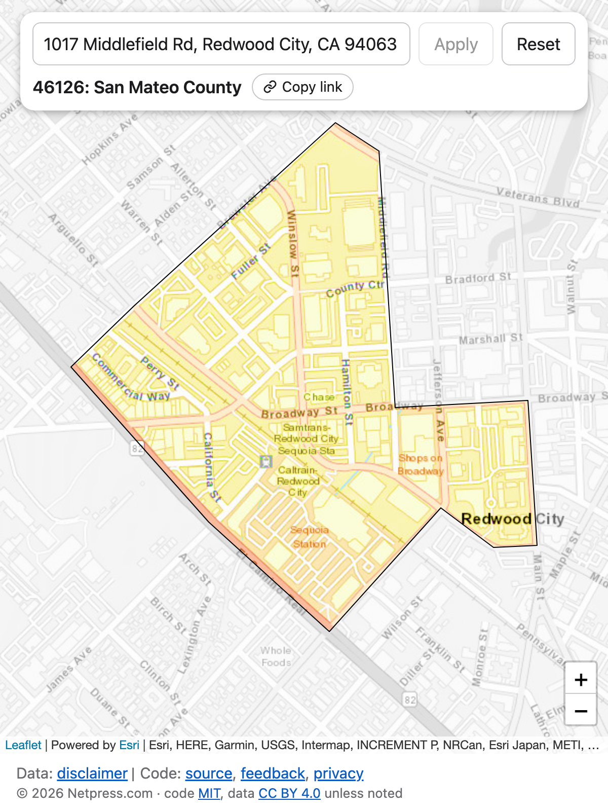

# Precinct lookup

[](https://www.npmjs.com/package/precinct-lookup)
[](https://github.com/woodie/street-ranges/actions/workflows/ci.yml)
[](LICENSE)

Finding a voter's precinct from an address usually means sending the address to an API.
Counties already publish the required information.

`precinct-lookup` turns a street address into a precinct, and the precinct's shape for a map, right
in the browser. It reads small static files of street ranges, built for all 58 California counties
from each county's public data. The [sample app](https://precinct.netpress.com/) shows each
precinct on a map.

<p>
  
  
  
</p>

- **Compact data:** a zipcode's ranges are one small JSON file, on any static host. No database,
  no server.
- **Privacy:** the address never leaves the device. Only that zipcode's files are fetched, and the
  ranges hold no voter data.
- **Data compliance:** each county's `DISCLAIMER.txt` carries the county's own words, its sources
  and how current they are, and any license, linked with each answer.
- **Small counties:** a county that keeps its precinct map and addresses as public layers can run
  its own lookup on a free host, with whatever it wants to show for each precinct.

## Use it in your app

```bash
npm install precinct-lookup
```

```js
import { lookup, outline, remoteSource } from 'precinct-lookup'

const source = remoteSource()  // the California files, or remoteSource('https://your.copy/counties/')
const answer = await lookup('701 Laurel St, Menlo Park, CA 94025', source)
answer.text                    // '44013: San Mateo County'
answer.found                   // { county: '41', number: '44013', zip: '94025' }
const shape = await outline(answer.found, source)  // GeoJSON
```

A page without a build step can load it from a CDN:
`import { lookup, remoteSource } from 'https://cdn.jsdelivr.net/npm/precinct-lookup/+esm'`.
What a precinct means (its districts, representatives or polling place) is left to your app;
[Your own county lookup](docs/COUNTY_LOOKUP.md) shows one way.

## Sources

Each county's ranges come from the best it publishes: each address with its precinct, address
points or parcels placed on its precinct map, or Census TIGER where there's nothing else.
[Sources](docs/SOURCES.md) explains the approach, [GIS data by county](docs/GIS_DATA.md) lists what
each county publishes, and [Public precinct data](docs/PUBLIC_PRECINCT_DATA.md) shows why a county
publishing each address's precinct matters most. The file layout, build rules and how to make
ranges for your own area are in [Developer notes](docs/DEVELOPER.md).

The code is MIT; the data in `counties/` is [CC BY 4.0](https://creativecommons.org/licenses/by/4.0/),
crediting each county's sources, unless a county's `DISCLAIMER.txt` lists its own license.
